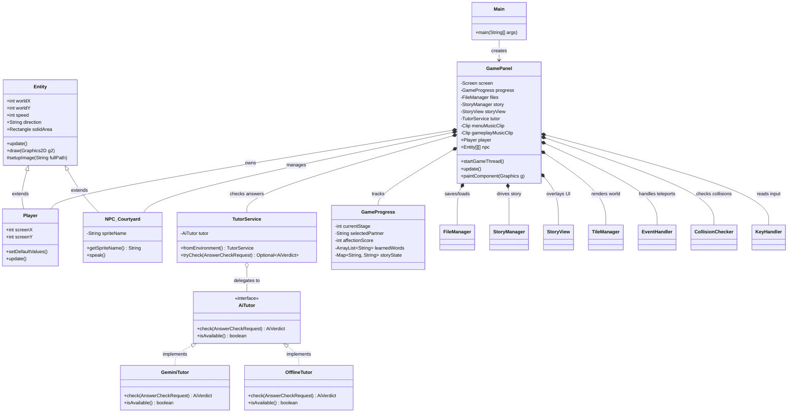

<div align="center">
  

  <h3>A Philippine Regional Language-Learning Visual Novel & Campus RPG</h3>

  <p>
    <i>"Every language has a story. Sometimes, finding the right words is where yours begins."</i> 💗
  </p>

  <p>
    
    
    
    
  </p>
</div>

---

## 🌸 Project Overview

**In Other Words** is a story-driven Java 2D campus RPG and visual novel dating simulator where romance meets Philippine regional language learning.

Arriving at a new university, you meet three classmates from different regions of the Philippines — **Jessa** (*Bisaya / Cebuano*), **Inna** (*Ilokano*), and **Nikka** (*Central Bikol*). Explore seven interconnected maps, talk to your clubmates, build your vocabulary notebook, and test your fluency through interactive dialogue choices, Study Breaks, and typed responses. Your language mastery and choices shape your affection score and determine how your story ends.

---

## ✨ Project Features

- 🗺️ **2D Campus & Hometown Exploration** — Walk freely across 7 connected tile maps (`Courtyard`, `Hallway`, `Classroom`, `Library`, `Garden / Balcony`, `Hometown`, and `Bedroom`) with smooth collision handling and doorway teleportation.
- 💬 **Three Language Partners & Routes** — Choose your project partner and learn **Bisaya (Cebuano)** with Jessa, **Ilokano** with Inna, or **Central Bikol** with Nikka across a 4-chapter storyline.
- 🎨 **Animated Studio Intro & Custom Swing UI** — Features a fade-in/fade-out studio intro (*"AN ORIGINAL PROJECT BY POWERPUFFGIRLS — GROUP 3 - CS2103"*), parallax plaid main menu, floating heart click particles, and highlighted dialect words.
- 🎵 **Dual Looping Soundtrack & Live Volume Controls** — Plays a dedicated looping main-menu theme after the intro, switches seamlessly to a continuous gameplay theme during your adventure, and supports real-time **Music Volume** dragging and **Mute All** in Settings.
- 📖 **Interactive Vocabulary Log (Dictionary)** — Browse heard and learned words, filter by dialect (`All`, `Cebuano`, `Ilokano`, `Central Bikol`), and search by word or English meaning.
- 🤖 **Dynamic Answer Checking (Gemini AI + Offline Fallback)** — Supports multiple-choice prompts in early chapters and typed answers in later chapters, powered by an optional `GeminiTutor` (`GEMINI_API_KEY`) with a built-in `OfflineTutor` fallback so the game never requires an internet connection.
- 💾 **Save & Load System + Multiple Endings** — Save your chapter, affection score, learned words, and exact map coordinates to disk via `FileManager`, and unlock different endings based on your rapport and quiz performance.

---

## 🧩 OOP Principles Applied

**In Other Words** is architected around the four core pillars of Object-Oriented Programming:

### 1. Encapsulation
- **[`VocabularyEntry`](src/data/VocabularyEntry.java):** Stores `word`, `meaning`, `dialect`, and `difficulty` as `private` fields, validating and normalizing every update through `requireText(...)` in its setters.
- **[`GameProgress`](src/data/GameProgress.java):** Protects `currentStage` (`1–4`), `selectedPartner`, `affectionScore`, `learnedWords`, and `storyState` as `private` fields and returns defensive copies in `getStoryState()`.
- **[`NPC_Courtyard`](src/entity/NPC_Courtyard.java) & [`GamePanel`](src/main/GamePanel.java):** Keep sprite caches, audio clips (`menuMusicClip`, `gameplayMusicClip`), and volume controls `private`, exposing only controlled methods like `getSpriteName()` and `applyMusicVolume()`.

### 2. Inheritance
- **[`Player`](src/entity/Player.java) & [`NPC_Courtyard`](src/entity/NPC_Courtyard.java) → `extends Entity`:** Both inherit shared world coordinates, speed, collision hitboxes (`solidArea`), rendering (`draw`), and image scaling (`setupImage`) from [`Entity`](src/entity/Entity.java).
- **[`GamePanel`](src/main/GamePanel.java) & [`StoryView`](src/story/StoryView.java) → `extends JPanel`:** Inherit Swing's component lifecycle, layout, and custom 2D graphics rendering.
- **[`EventRect`](src/main/EventRect.java) → `extends Rectangle` & [`AiException`](src/ai/AiException.java) → `extends Exception`:** Reuse standard Java classes while adding domain-specific event and error behavior.

### 3. Polymorphism
- **Subtype Polymorphism (`Entity`):** `GamePanel` sorts and renders `Player` and `NPC_Courtyard` instances together inside `ArrayList<Entity> entityList` and `Entity[][] npc`, dispatching `update()` and `draw(Graphics2D)` dynamically at runtime.
- **Interface Polymorphism (`AiTutor`):** [`TutorService`](src/ai/TutorService.java) holds an [`AiTutor`](src/ai/AiTutor.java) reference that can seamlessly be either a [`GeminiTutor`](src/ai/GeminiTutor.java) or an [`OfflineTutor`](src/ai/OfflineTutor.java).
- **Method Overriding & Overloading:** Overrides Swing lifecycle methods (`paintComponent`, `paintChildren`, `doLayout`, `removeNotify`) and input adapters (`mousePressed`, `mouseDragged`, `keyPressed`), alongside overloaded constructors in `Entity`, `NPC_Courtyard`, and `GamePanel`.

### 4. Abstraction
- **[`AiTutor`](src/ai/AiTutor.java) & [`TutorService`](src/ai/TutorService.java):** Hide HTTP requests, JSON parsing, API-key checks, and fallback error handling behind simple methods (`isReady()`, `tryCheck(...)`).
- **[`KeyHandler`](src/main/KeyHandler.java):** Implements `KeyListener` to abstract raw Swing key codes into clean directional movement flags (`upPressed`, `downPressed`, `leftPressed`, `rightPressed`).
- **Audio & Rendering Helpers in [`GamePanel`](src/main/GamePanel.java):** High-level helpers like `loadMusicClip(...)`, `startGameplayMusic(...)`, `pauseGameplayMusic()`, and `applyClipVolume(...)` abstract away `javax.sound.sampled` streams and logarithmic dB gain math.

---

## 📁 Project Structure

```text
In Other Words/
├── notes/
│   └── runProgram.txt              # Quick build & control reference
├── resources/ & saves/             # Runtime save data directory
└── src/
    ├── ai/                         # AI & offline answer-checking layer
    │   ├── AiTutor.java            # Tutor interface (abstraction)
    │   ├── GeminiTutor.java        # Gemini API implementation
    │   ├── OfflineTutor.java       # Local fallback tutor
    │   ├── TutorService.java       # Facade with safe fallback
    │   └── ...                     # Config, client, parser, verdict, request
    ├── assets/                     # Game media & map files
    │   ├── audio/                  # menuMusic.wav & gameplayMusic.wav
    │   ├── maps/                   # 7 world maps (courtyard, hallway, classroom, etc.)
    │   ├── npc/                    # jessaNPC.png, innaNPC.png, nikkaNPC.png
    │   ├── player/                 # Player walking sprites
    │   ├── sprites/                # Character portraits & dialogue UI sprites
    │   └── tiles/                  # Tileset graphics
    ├── data/                       # Persistence & progress models
    │   ├── Dictionary.java
    │   ├── FileManager.java
    │   ├── GameProgress.java
    │   └── VocabularyEntry.java
    ├── entity/                     # World entities
    │   ├── Entity.java             # Base entity class
    │   ├── Player.java             # Controllable player
    │   └── NPC_Courtyard.java      # Parameterized courtyard/campus NPC
    ├── main/                       # Core engine & Swing UI
    │   ├── Main.java               # Entry point (JFrame)
    │   ├── GamePanel.java          # Game loop, screens, audio, HUD, settings
    │   ├── AssetSetter.java        # NPC placement & scene updates
    │   ├── CollisionChecker.java   # Tile & entity collision detection
    │   ├── EventHandler.java       # Doorway map teleportation
    │   ├── EventRect.java
    │   ├── KeyHandler.java
    │   └── UtilityTool.java
    ├── mechanics/                  # Story & gameplay rules
    │   ├── AffectionManager.java
    │   ├── AnswerValidator.java
    │   ├── DialogueManager.java
    │   ├── EndingManager.java
    │   ├── PartnerManager.java
    │   └── StageManager.java
    ├── resources/story/            # Authored TSV story script & sprite table
    │   ├── story.tsv
    │   └── sprites.tsv
    ├── story/                      # Story runtime & visual-novel overlay
    │   ├── DialectHighlighter.java
    │   ├── StoryManager.java
    │   ├── StoryScript.java
    │   ├── StorySprites.java
    │   └── StoryView.java
    └── tile/                       # Map tile loading & rendering
        ├── Tile.java
        └── TileManager.java
```

### 📐 UML Class Diagram



---

## ▶️ How to Run the Program

### Prerequisites
- **Java Development Kit (JDK) 17 or later**
- *(Optional)* Set `GEMINI_API_KEY` in your environment variables if you want to enable the online AI Tutor; otherwise, the game automatically uses `OfflineTutor`.

### Build & Run (PowerShell / Windows)

Run these commands from the project root directory (`In Other Words`):

```powershell
javac -encoding UTF-8 -d out (Get-ChildItem -Recurse -Filter *.java -Path src).FullName
Copy-Item -Recurse -Force src\assets out\
Copy-Item -Recurse -Force src\resources out\
java -cp out main.Main
```

### 🎮 Controls
| Input | Action |
|---|---|
| `W` `A` `S` `D` | Move your character around the map |
| `E` | Talk to a nearby classmate / resume the current scene |
| `Enter` / `Space` | Skip intro or advance dialogue |
| `1` – `3` | Choose a dialogue option |
| `Type` + `Enter` | Submit a typed language answer |
| `Esc` | Toggle between dialogue view and campus map / go back |
| `Ctrl + S` / `Ctrl + L` | Quick Save / Quick Load progress |

---

## 🌟 Highlights & Gameplay Flow

```text
[Studio Intro Fade] ──▶ [Plaid Main Menu + Looping Menu Music]
                              │
              ┌───────────────┴───────────────┐
              ▼                               ▼
     [New Game / Load]               [Dictionary / Settings]
              │                       • Filter Bisaya, Ilokano, Bikol
              ▼                       • Adjust Music & Volume Sliders
 [Campus Exploration + Gameplay Music]
   • Explore 7 maps (Courtyard, Hallway, Classroom, Library, Garden, Hometown, Bedroom)
   • Talk to Jessa, Inna, or Nikka (E) ──▶ Learn regional phrases & earn ♥ Affection
```

- **Studio Intro:** Displays the animated *"AN ORIGINAL PROJECT BY POWERPUFFGIRLS — GROUP 3 - CS2103"* badge over the signature cream-and-pink plaid backdrop before transitioning into the main menu.
- **HUD & Quest Goal Banner:** Shows your current chapter, partner name, live affection heart count (`♥`), and next location goal so you always know which room or classmate to visit next.
- **Vocabulary Notebook:** Automatically logs newly encountered regional words and marks them as **Heard** or **Learned** as you progress.

---

## 👥 Team Members

**PowerpuffGirls — Group 3 (CS2103)**

| Member | Role | GitHub |
|---|---|---|
| **Onikka Mae Buela** | Project Lead, Systems, Algorithm, and Narrative Design | [@NikzByte](https://github.com/NikzByte) |
| **Aaron Dave Montealto** | File Handling, Database Management, and AI Integration | [@25-05897-Aaron](https://github.com/25-05897-Aaron) |
| **Trisha Loraine Relativo** | UI/UX Design and Visual Direction | [@alstroemeriart](https://github.com/alstroemeriart) |

---

## 🙏 Acknowledgments

- **Batangas State University — Alangilan Campus**, for supporting this project under **OOP 101 – Object-Oriented Programming** (*Section CS2103, First Semester, A.Y. 2026–2027*).
- Our instructors and classmates for their feedback, playtesting, and encouragement.
- The rich linguistic heritage of **Bisaya (Cebuano)**, **Ilokano**, and **Central Bikol** speakers that inspired every conversation in this game.

---

## 💌 Thank You!

Thank you for checking out **In Other Words**! Whether you came for the campus story, the Java 2D architecture, or to pick up a few new words in Bisaya, Ilokano, or Bicolano — we hope you enjoy playing it as much as we enjoyed building it.

*Every language has a story. Sometimes, finding the right words is where yours begins.* 💗
