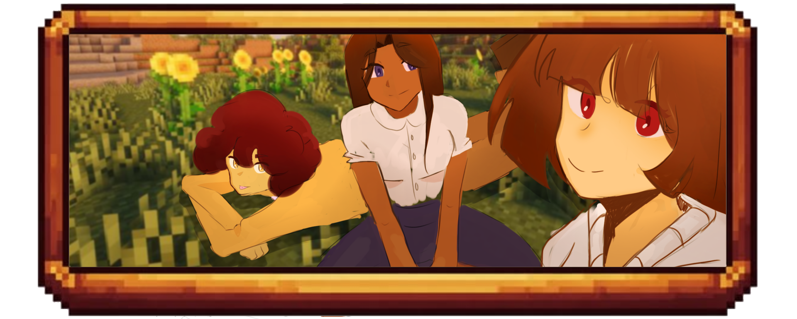
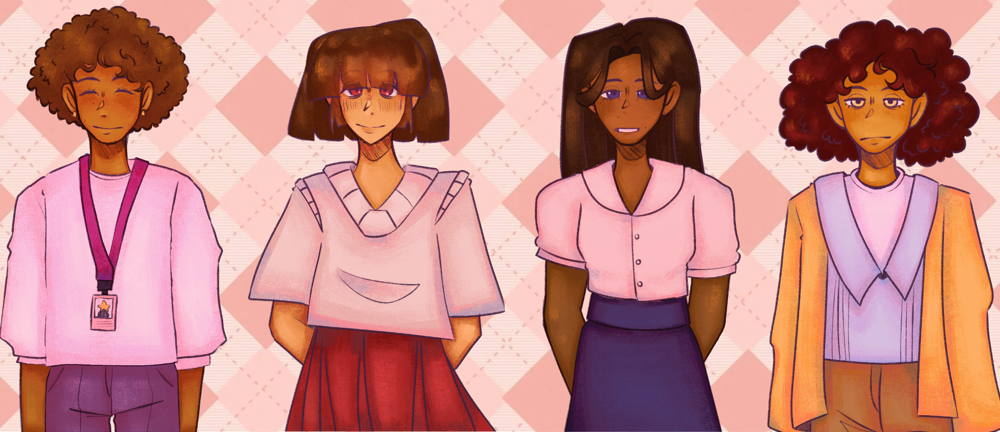

<div align="center">
  
  <h1>In Other Words 💌</h1>
  <h3>A Philippine Regional Language-Learning Visual Novel & Campus RPG</h3>

  <p>
    <i>"Every language has a story. Sometimes, finding the right words is where yours begins."</i> 
  </p>

</div>

---

## 🌸 Project Overview

**In Other Words** is a story-driven Java 2D campus RPG and visual novel dating simulator where romance meets Philippine regional language learning.

Arriving at a new university, you meet three classmates from different regions of the Philippines — **Jessa** (*Bisaya / Cebuano*), **Inna** (*Ilokano*), and **Nikka** (*Central Bikol*). Explore seven interconnected maps, talk to your clubmates, build your vocabulary notebook, and test your fluency through interactive dialogue choices, Study Breaks, and typed responses. Your language mastery and choices shape your affection score and determine how your story ends.

### Features
- 💬 Learn 3 Philippine regional languages: Cebuano, Ilokano, and Central Bikol
- 💕 Build relationships with 3 language partners through a 4-chapter story
- 🎮 Interactive dialogue choices and language challenges
- 📖 Vocabulary dictionary with word search and language filters
- 🤖 Gemini AI-powered answer checking with offline fallback
- 🎨 Animated intro, custom pixel art, and themed game interface
- 🏆 Multiple endings based on player choices and performance
  
---

## 🧩 Problem Description

The Philippines is home to a rich variety of regional languages and dialects, each representing the culture, identity, and heritage of different communities. However, many young Filipinos today are becoming less familiar with regional languages outside their own households or communities. As younger generations grow up using Filipino and English more frequently in their daily conversations, their exposure to languages such as Bisaya, Ilokano, and Bikol may become limited.

This growing unfamiliarity can create a communication gap between people from different regions and may lead to a gradual loss of appreciation for the country's linguistic diversity. Traditional learning methods may also feel less engaging to younger audiences, making it difficult to encourage them to explore and learn unfamiliar regional languages.

In Other Words aims to address this problem by introducing Philippine regional language learning through an interactive and entertaining experience. By combining storytelling, campus exploration, character interactions, and language challenges, the game encourages young players to discover new words, understand their meanings, and appreciate the cultural significance of regional languages.

---

## ⚙ OOP Principles Applied

**In Other Words** is architected around the four core pillars of Object-Oriented Programming:

### 1. Encapsulation
- **[`VocabularyEntry`](src/data/VocabularyEntry.java):** Stores `word`, `meaning`, `dialect`, and `difficulty` as `private` fields, validating and normalizing every update through `requireText(...)` in its setters.
```java
public class VocabularyEntry {
    private String word;
    private String meaning;
    private String dialect;
    private String difficulty;

    public String getWord() { return word; }

    public void setWord(String word) {
        this.word = requireText(word, "Word");
    }
}
```

### 2. Inheritance
- **[`Player`](src/entity/Player.java) & [`NPC_Courtyard`](src/entity/NPC_Courtyard.java) → `extends Entity`:** Both inherit shared world coordinates, speed, collision hitboxes (`solidArea`), rendering (`draw`), and image scaling (`setupImage`) from [`Entity`](src/entity/Entity.java).
```java
public class NPC_Courtyard extends Entity {
    private final String spriteName;

    public NPC_Courtyard(GamePanel gp, String spriteName) {
        super(gp);
        this.spriteName = spriteName;
        direction = "down";
        speed = 0;
        getImage();
    }
}
```

### 3. Polymorphism
- **Subtype Polymorphism (`Entity`):** `GamePanel` sorts and renders `Player` and `NPC_Courtyard` instances together inside `ArrayList<Entity> entityList` and `Entity[][] npc`, dispatching `update()` and `draw(Graphics2D)` dynamically at runtime.
```java
// src/ai/TutorService.java
public class TutorService {
    private final AiTutor tutor;

    public static TutorService fromEnvironment() {
        GeminiTutor gemini = GeminiTutor.fromEnvironment();
        return new TutorService(gemini.isAvailable() ? gemini : new OfflineTutor());
    }
}
```

---

## 📁 Project Structure

```text
In Other Words/
├── notes/
│   └── runProgram.txt              
├── resources/ & saves/             
└── src/
    ├── ai/                         
    │   ├── AiTutor.java            
    │   ├── GeminiTutor.java        
    │   ├── OfflineTutor.java       
    │   ├── TutorService.java       
    │   └── ...                     
    ├── assets/                     
    │   ├── audio/                  
    │   ├── maps/                   
    │   ├── npc/                    
    │   ├── player/                 
    │   ├── sprites/                
    │   └── tiles/                 
    ├── data/                       
    │   ├── Dictionary.java
    │   ├── FileManager.java
    │   ├── GameProgress.java
    │   └── VocabularyEntry.java
    ├── entity/                     
    │   ├── Entity.java            
    │   ├── Player.java            
    │   └── NPC_Courtyard.java      
    ├── main/                       
    │   ├── Main.java               
    │   ├── GamePanel.java          
    │   ├── AssetSetter.java        
    │   ├── CollisionChecker.java   
    │   ├── EventHandler.java       
    │   ├── EventRect.java
    │   ├── KeyHandler.java
    │   └── UtilityTool.java
    ├── mechanics/                  
    │   ├── AffectionManager.java
    │   ├── AnswerValidator.java
    │   ├── DialogueManager.java
    │   ├── EndingManager.java
    │   ├── PartnerManager.java
    │   └── StageManager.java
    ├── resources/story/            
    │   ├── story.tsv
    │   └── sprites.tsv
    ├── story/                      
    │   ├── DialectHighlighter.java
    │   ├── StoryManager.java
    │   ├── StoryScript.java
    │   ├── StorySprites.java
    │   └── StoryView.java
    └── tile/                      
        ├── Tile.java
        └── TileManager.java
```
<div align="center">
  
</div>

---

## ▶️ How to Run the Program

### Prerequisites
- **Java Development Kit (JDK) 17 or later**
- *(Optional)* Set `GEMINI_API_KEY` in your environment variables if you want to enable the online AI Tutor; otherwise, the game automatically uses `OfflineTutor`.

### Build & Run (PowerShell / Windows)

Run these commands from the project root directory (`In Other Words`):

```powershell
javac -encoding UTF-8 -d out (Get-ChildItem -Recurse -Filter *.java -Path src).FullName
Copy-Item -Recurse -Force src\assets out\
Copy-Item -Recurse -Force src\resources out\
java -cp out main.Main
```

### 🎮 Controls
| Input | Action |
|---|---|
| `W` `A` `S` `D` | Move your character around the map |
| `E` | Talk to a nearby classmate / resume the current scene |
| `Enter` / `Space` | Skip intro or advance dialogue |
| `1` – `3` | Choose a dialogue option |
| `Type` + `Enter` | Submit a typed language answer |
| `Esc` | Toggle between dialogue view and campus map / go back |
| `Ctrl + S` / `Ctrl + L` | Quick Save / Quick Load progress |

---

## 🌟 Gameplay Flow

```text
[Studio Intro Fade] ──▶ [Plaid Main Menu + Looping Menu Music]
                              │
              ┌───────────────┴───────────────┐
              ▼                               ▼
     [New Game / Load]               [Dictionary / Settings]
              │                       • Filter Bisaya, Ilokano, Bikol
              ▼                       • Adjust Music & Volume Sliders
 [Campus Exploration + Gameplay Music]
   • Explore 7 maps (Courtyard, Hallway, Classroom, Library, Garden, Hometown, Bedroom)
   • Talk to Jessa, Inna, or Nikka (E) ──▶ Learn regional phrases & earn ♥ Affection
```

---

## 👥 Team Members

**PowerpuffGirls — Group 3 (CS2103)**

| Member | Role | GitHub |
|---|---|---|
| **Onikka Mae Buela** | Project Lead, Systems, Algorithm, and Narrative Design | [@NikzByte](https://github.com/NikzByte) |
| **Aaron Dave Montealto** | File Handling, Database Management, and AI Integration | [@25-05897-Aaron](https://github.com/25-05897-Aaron) |
| **Trisha Loraine Relativo** | UI/UX Design and Visual Direction | [@alstroemeriart](https://github.com/alstroemeriart) |

---

## 🙏 Acknowledgments

- **Batangas State University — Alangilan Campus**, for supporting this project under **OOP 101 – Object-Oriented Programming** (*Section CS2103, First Semester, A.Y. 2026–2027*).
- Our instructors and classmates for their feedback, playtesting, and encouragement.
- The rich linguistic heritage of **Bisaya (Cebuano)**, **Ilokano**, and **Central Bikol** speakers that inspired every conversation in this game.

---

## 💌 Thank You!

Thank you for checking out **In Other Words**! Whether you came for the campus story, the Java 2D architecture, or to pick up a few new words in Bisaya, Ilokano, or Bicolano — we hope you enjoy playing it as much as we enjoyed building it.

*Every language has a story. Sometimes, finding the right words is where yours begins.* 💗
